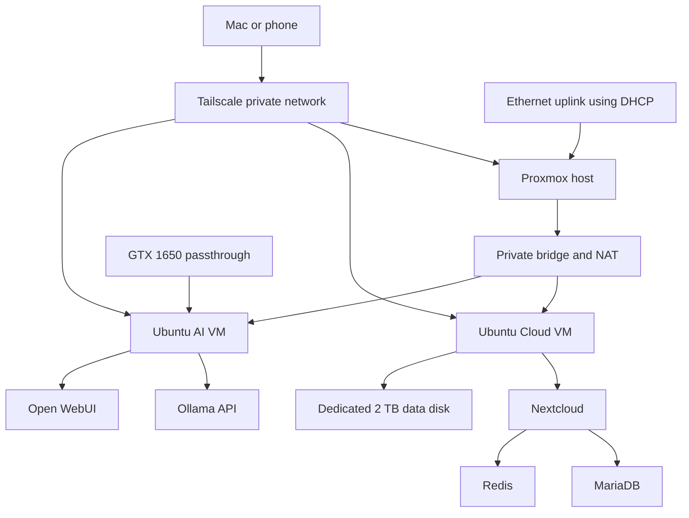

# Proxmox Homelab

A personal homelab for self-hosted cloud storage, GPU-enabled AI, and remote administration. It runs two Ubuntu virtual machines on Proxmox: a Nextcloud server with MariaDB and Redis, and an AI server with Ollama and Open WebUI. Tailscale provides access from other networks.

The project also documents a real recovery: diagnosing a host startup failure, protecting a damaged cloud filesystem before repairing it, restoring guest networking after a move to a dorm, and verifying that the services return after reboot.

**Last operational verification:** November 9, 2026. **Documentation prepared:** November 13, 2026. These dates describe recorded tests, not continuous uptime monitoring.

## Architecture

The guest bridge is separate from the physical uplink. The host supplies private DHCP, DNS, and NAT; each VM connects to Tailscale independently. The Cloud VM exclusively owns its physical data disk.

## Hardware and virtual machines

| Resource | Configuration |
|---|---|
| Host | AMD Ryzen platform, MSI AM4 motherboard, 32 GiB RAM |
| System storage | 1 TB Kingston NVMe SSD |
| Cloud storage | Dedicated 2 TB Seagate SATA disk |
| GPU | ASUS NVIDIA GTX 1650, 4 GiB VRAM |
| Hypervisor | Proxmox on Debian 13; recovered kernel 6.17.13-2-pve |
| Cloud VM | Ubuntu, 2 vCPU, 4032 MiB RAM, 50 GiB virtual system disk |
| AI VM | Ubuntu, 4 vCPU, 16 GiB RAM, 82 GiB virtual system disk, GPU passthrough |

The exact CPU SKU and motherboard model were not established in the recovery record.

## What works

- Remote Proxmox and host SSH access through Tailscale, including a phone-hotspot test.
- Nextcloud with MariaDB and Redis on the dedicated cloud drive.
- Ollama model discovery and a successful inference test using `gemma3:1b`.
- Open WebUI with a healthy container and a responding web interface.
- NVIDIA GPU recognition inside the AI VM.
- Guest internet access through a private bridge, DHCP reservations, DNS, and NAT.
- Automatic VM and application startup after a controlled host reboot.

A successful health response is not a full application acceptance test. See [validation and limitations](docs/validation.md) for exactly what was checked.

## The recovery

The host appeared stuck after a root filesystem check. Offline inspection found a directory-index error on the separate cloud-data partition. The host and Cloud VM were also configured to mount the same filesystem, creating a plausible corruption risk.

The recovery proceeded in stages:

1. Restore persistent host access while leaving the data drive untouched and VMs stopped.
2. Back up allocated filesystem blocks, including file contents, to a separate logical volume on the system SSD.
3. Test repairs on a copy and compare directory inventories before repairing the original offline.
4. Give the Cloud VM exclusive disk ownership and require the data mount before Docker starts.
5. Restore guest networking, expand the Cloud VM's full root filesystem using existing free LVM space, and renew guest Tailscale authentication.
6. Restart the host and verify that remote access, VMs, and applications return automatically.

Read the [incident case study](docs/recovery-case-study.md) for the findings, evidence, and limits.

## Repository guide

| Path | Contents |
|---|---|
| [Architecture](docs/architecture.md) | Network, storage, VM, and service design |
| [Recovery case study](docs/recovery-case-study.md) | Diagnosis, backup, repair, and restoration |
| [Validation](docs/validation.md) | Test outcomes and unverified areas |
| [Operations](docs/operations.md) | Routine checks and troubleshooting |
| [Roadmap](docs/roadmap.md) | Backup improvements, photo migration, and AI plans |
| [Configuration examples](config/examples/README.md) | Sanitized reference snippets with replacement values |
| [Publication check](scripts/check_publication.py) | Checks for common accidental private-file additions |

## Scope and privacy

This is documentation of a working homelab and its recovery, with selected configuration examples. It is not a complete automated deployment, a production service, or a promise of current availability.

Public examples use replacement addresses, device paths, and MAC addresses. Live Tailscale addresses, campus addresses, disk serials and UUIDs, personal files, credentials, private keys, backup images, database dumps, and the private project reference document are excluded.

The recovery backup and OS snapshots reside on the host SSD. They are useful rollback material but are **not an independent external backup**. Building and testing that backup is a remaining task.

## Skills demonstrated

Proxmox virtualization · Linux administration · Tailscale remote access · DHCP and NAT · Docker Compose · Nextcloud · LVM and ext4 recovery · GPU passthrough · Ollama · Backup planning · Evidence-based troubleshooting
